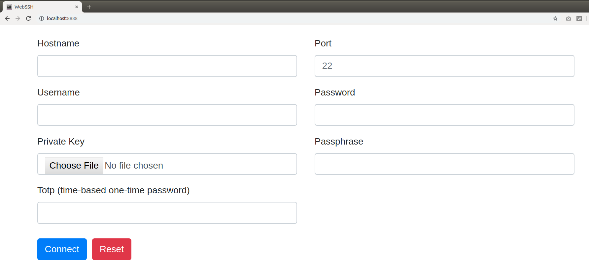
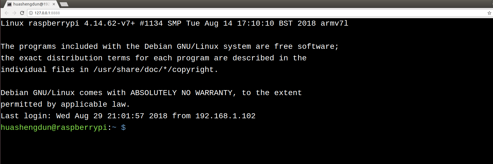

## WebSSH

[](https://github.com/huashengdun/webssh/actions/workflows/python.yml)
[](https://raw.githubusercontent.com/huashengdun/webssh/coverage-badge/coverage.svg)


### Introduction

A simple web application to be used as an ssh client to connect to your ssh servers. It is written in Python, base on tornado, paramiko and xterm.js.

### Features

* SSH password authentication supported, including empty password.
* SSH public-key authentication supported, including DSA RSA ECDSA Ed25519 keys.
* Encrypted keys supported.
* Two-Factor Authentication (time-based one-time password) supported.
* Fullscreen terminal supported.
* Terminal window resizable.
* Persistent tty sessions with reconnect tokens.
* Session management page for open persistent ttys.
* Auto detect the ssh server's default encoding.
* Modern browsers including Chrome, Firefox, Safari, Edge, Opera supported.


### Preview





### How it works
```
+---------+     http     +--------+    ssh    +-----------+
| browser | <==========> | webssh | <=======> | ssh server|
+---------+   websocket  +--------+    ssh    +-----------+
```

### Requirements

* Python 3.10+


### Quickstart

1. Install this app, run command `pip install webssh`
2. Start a webserver, run command `wssh`
3. Open your browser, navigate to `127.0.0.1:8888`
4. Input your data, submit the form.

### Persistent tty sessions

CacheSSH keeps the remote SSH connection alive after a browser tab closes. To
create a session:

1. Open the connection page and enter the target SSH credentials.
2. Enter a strong, URL-safe value in `Access Token`. This is the session
   password used by browsers and terminal SSH clients. If left empty, CacheSSH
   generates a random value.
3. Select **Connect** and keep the resulting token somewhere safe.

To reattach from another browser or device, open the same CacheSSH server,
enter only the `Access Token`, and select **Connect**. The newest attachment
takes control and disconnects the previous browser or terminal client.

Tokens may contain `A-Z`, `a-z`, `0-9`, `_`, `.`, `~`, and `-`, up to 128
characters. Use at least 16 random characters when you choose the value.

WebSSH keeps a bounded ANSI replay buffer for each tty. When you reattach,
the browser receives the recent terminal stream again so xterm.js can rebuild
the visible screen, which is closer to a tmux attach than a blank reconnect.
Use `--output_cache_size` to tune the retained replay bytes.
The default replay limit is 256 KiB. In the browser, xterm.js automatically
discards the oldest history beyond 300 lines on mobile devices and 1000 lines
on larger screens.

New shells are opened with `TERM=xterm-256color`, `COLORTERM=truecolor`,
`CLICOLOR=1`, and `FORCE_COLOR=3` so modern CLIs can emit 256-color and
24-bit color sequences when they support them.

Open `/sessions` to view, attach to, or close retained sessions. The default
manager password is `1234`; change it immediately after the first login. Set a
unique `WEBSSH_COOKIE_SECRET` in any remotely accessible deployment.

### Terminal SSH gateway

CacheSSH can expose the same retained sessions to OpenSSH and other terminal
clients. Start the web service and SSH gateway together:

```bash
WEBSSH_COOKIE_SECRET="$(openssl rand -hex 32)" \
wssh --address=0.0.0.0 --port=8888 \
  --ssh_gateway_address=0.0.0.0 --ssh_gateway_port=2222
```

First create a session in the web UI and choose an `Access Token`. Then connect
from a terminal and enter that token at the SSH password prompt:

```bash
ssh -p 2222 cache@cachessh-host
```

The SSH username is only a label; `cache` is recommended. A successful password
authentication immediately attaches the session identified by that token.

Public-key authentication is optional. Enable it with:

```bash
wssh --ssh_gateway_port=2222 \
  --ssh_gateway_authorized_keys="$HOME/.ssh/authorized_keys"
```

After public-key authentication, paste the token at the `CacheSSH token` prompt
or pass an attach command:

```bash
ssh -t -p 2222 cache@cachessh-host 'attach ACCESS_TOKEN'
```

On first start CacheSSH creates `env/ssh_gateway_host_key`. Keep this file to
avoid SSH host-key warnings after restarts, or choose another location with
`--ssh_gateway_host_key`.

Session state lives in the CacheSSH process. Browser and terminal disconnects
do not end it, but restarting CacheSSH does. The remote side closing the shell
or closing it from `/sessions` also ends it.


### Server options

```bash
# start a http server with specified listen address and listen port
wssh --address='2.2.2.2' --port=8000

# start a https server, certfile and keyfile must be passed
wssh --certfile='/path/to/cert.crt' --keyfile='/path/to/cert.key'

# missing host key policy
wssh --policy=reject

# logging level
wssh --logging=debug

# log to file
wssh --log-file-prefix=main.log

# more options
wssh --help
```

### Browser console

```javascript
// connect to your ssh server
wssh.connect(hostname, port, username, password, privatekey, passphrase, totp);

// connect with a persistent access token
wssh.connect(hostname, port, username, password, privatekey, passphrase, totp, token);

// pass an object to wssh.connect
var opts = {
  hostname: 'hostname',
  port: 'port',
  username: 'username',
  password: 'password',
  privatekey: 'the private key text',
  passphrase: 'passphrase',
  totp: 'totp',
  token: 'access token'
};
wssh.connect(opts);

// without an argument, wssh will use the form data to connect
wssh.connect();

// set a new encoding for client to use
wssh.set_encoding(encoding);

// reset encoding to use the default one
wssh.reset_encoding();

// send a command to the server
wssh.send('ls -l');
```

### Custom Font

To use custom font, put your font file in the directory `webssh/static/css/fonts/` and restart the server.

### URL Arguments

Support passing arguments by url (query or fragment) like following examples:

Passing form data (password must be encoded in base64, privatekey not supported)
```bash
http://localhost:8888/?hostname=xx&username=yy&password=str_base64_encoded
```

Passing a terminal background color
```bash
http://localhost:8888/#bgcolor=green
```

Passing a terminal font color
```bash
http://localhost:8888/#fontcolor=red
```

Passing a user defined title
```bash
http://localhost:8888/?title=my-ssh-server
```

Passing an encoding
```bash
http://localhost:8888/#encoding=gbk
```

Passing a font size
```bash
http://localhost:8888/#fontsize=24
```

Passing a command executed right after login
```bash
http://localhost:8888/?command=pwd
```

Passing a terminal type
```bash
http://localhost:8888/?term=xterm-256color
```

Passing an access token for persistent tty reconnect
```bash
http://localhost:8888/?token=my-token
```

### Use Docker

Start up the app
```
docker-compose up
```

Tear down the app
```
docker-compose down
```

### Tests

Requirements
```
pip install pytest pytest-cov codecov flake8 mock
```

Use unittest to run all tests
```
python -m unittest discover tests
```

Use pytest to run all tests
```
python -m pytest tests
```

### Deployment

Running behind an Nginx server

```bash
wssh --address='127.0.0.1' --port=8888 --policy=reject
```
```nginx
# Nginx config example
location / {
    proxy_pass http://127.0.0.1:8888;
    proxy_http_version 1.1;
    proxy_read_timeout 300;
    proxy_set_header Upgrade $http_upgrade;
    proxy_set_header Connection "upgrade";
    proxy_set_header Host $http_host;
    proxy_set_header X-Real-IP $remote_addr;
    proxy_set_header X-Real-PORT $remote_port;
}
```

Running as a standalone server
```bash
wssh --port=8080 --sslport=4433 --certfile='cert.crt' --keyfile='cert.key' --xheaders=False --policy=reject
```


### Tips

* For whatever deployment choice you choose, don't forget to enable SSL.
* By default plain http requests from a public network will be either redirected or blocked and being redirected takes precedence over being blocked.
* Try to use reject policy as the missing host key policy along with your verified known_hosts, this will prevent man-in-the-middle attacks. The idea is that it checks the system host keys file("~/.ssh/known_hosts") and the application host keys file("./known_hosts") in order, if the ssh server's hostname is not found or the key is not matched, the connection will be aborted.
